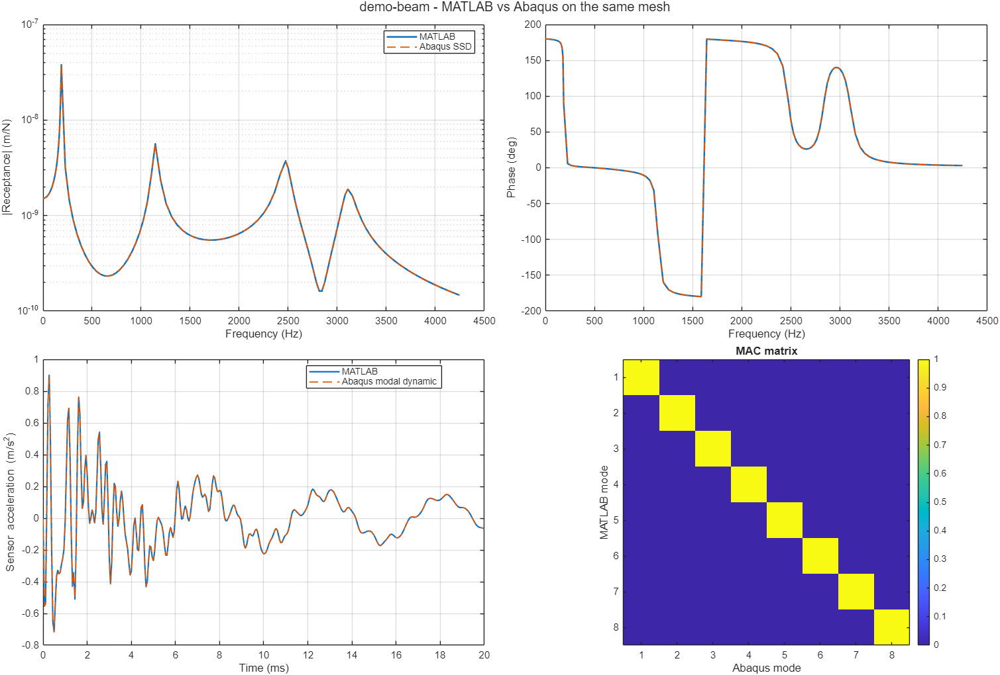
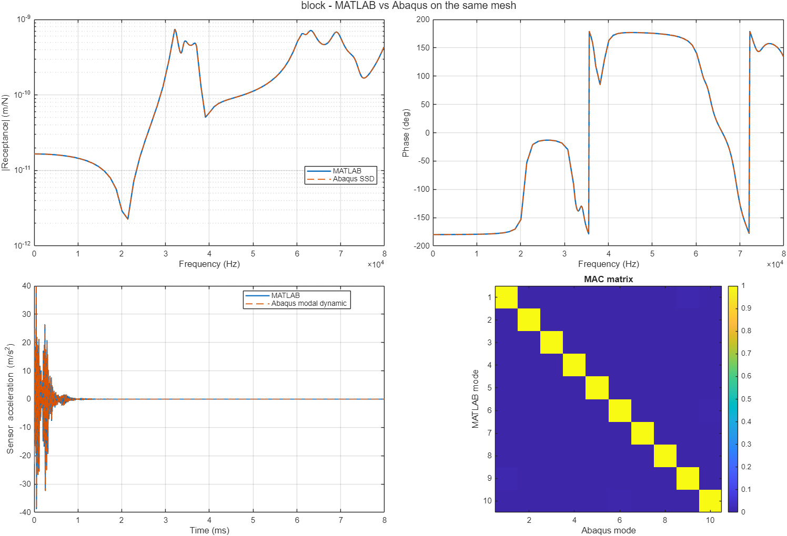
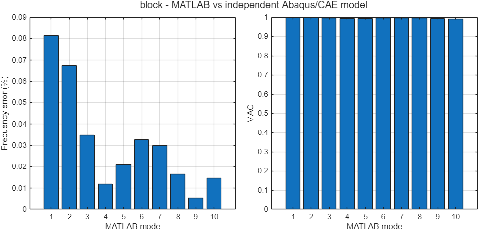
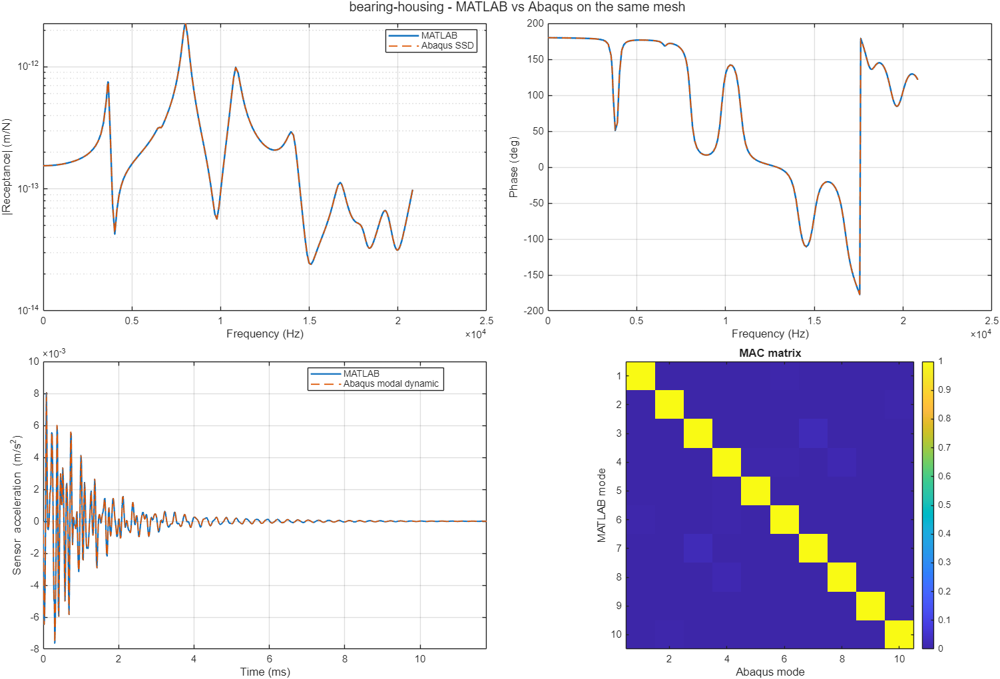
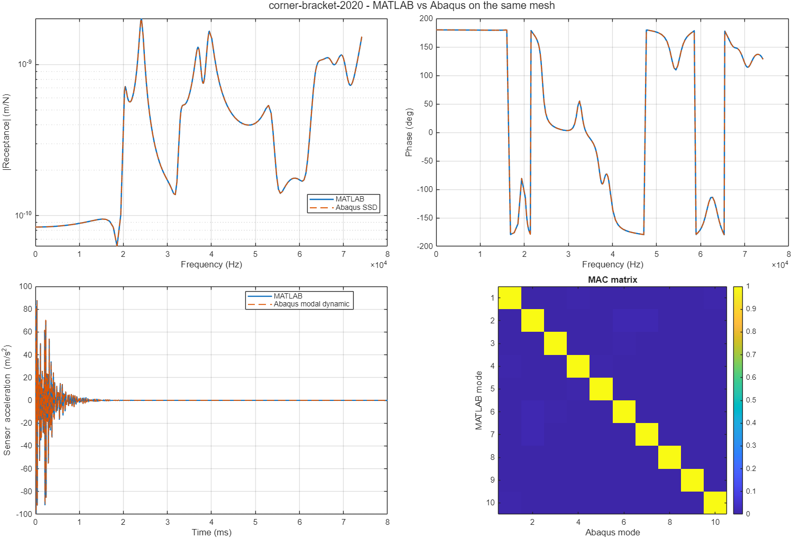
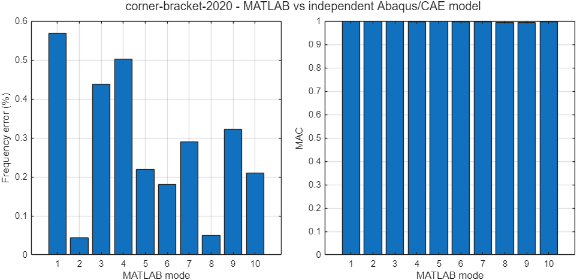

# Verification against Abaqus 2024

Generated by `verification/runVerification.m` on 2026-10-30 01:28.
Material for all parts: E = 210 GPa, nu = 0.3, rho = 7800 kg/m^3. Damping 2% of critical in every mode.

## Summary

| Case | Nodes | Modes | Same mesh max \|df\| (%) | Same mesh min MAC | FRF rel. error | Impact rel. error | Independent max \|df\| (%) | Independent min MAC | Refinement max \|df\| (%) |
|---|---|---|---|---|---|---|---|---|---|
| demo-beam | 8188 | 8 | 0.0036 | 1.0000 | 1.23e-06 | 6.75e-07 | n/a | n/a | 0.21 |
| block | 4758 | 10 | 0.0007 | 1.0000 | 9.18e-07 | 2.05e-06 | 0.08 | 0.991 | 0.14 |
| bearing-housing | 26398 | 10 | 0.0024 | 1.0000 | 6.92e-07 | 1.02e-06 | Abaqus could not mesh the CAD | - | 0.83 |
| corner-bracket-2020 | 10258 | 10 | 0.0020 | 1.0000 | 7.59e-07 | 1.34e-06 | 0.57 | 0.993 | 1.15 |

*Same mesh*: Abaqus solves the MATLAB mesh (solver, normalization, FRF and impact integration). *Independent*: Abaqus/CAE imports and meshes the STEP itself; MAC uses the nearest MATLAB node. *Refinement*: MATLAB frequency change when the element size is reduced to 0.7x (discretization error estimate).

## demo-beam

Size [0.3 0.02 0.02] m (file units: m). Meshed mass 0.936 kg. Band 0-4333 Hz. Hammer node 6 (Z), sensor node 627 (Y).
Mesh refinement: element size 6 -> 4.2 mm (8188 -> 23692 nodes) changes the frequencies by at most 0.21%.
Euler-Bernoulli first bending mode: 186.265 Hz; MATLAB: 186.277 Hz (0.007%).

| Mode | MATLAB (Hz) | Abaqus same mesh (Hz) | Error (%) | MAC | MATLAB 0.7h (Hz) | Change (%) |
|---|---|---|---|---|---|---|
| 1 | 186.28 | 186.28 | -0.0017 | 1.0000 | 186.23 | 0.027 |
| 2 | 186.28 | 186.28 | 0.0020 | 1.0000 | 186.23 | 0.029 |
| 3 | 1144.04 | 1144.00 | 0.0036 | 1.0000 | 1143.71 | 0.029 |
| 4 | 1144.09 | 1144.10 | -0.0012 | 1.0000 | 1143.73 | 0.031 |
| 5 | 2472.72 | 2472.70 | 0.0009 | 1.0000 | 2467.57 | 0.209 |
| 6 | 3107.62 | 3107.60 | 0.0006 | 1.0000 | 3106.62 | 0.032 |
| 7 | 3107.74 | 3107.70 | 0.0014 | 1.0000 | 3106.69 | 0.034 |
| 8 | 4333.17 | 4333.20 | -0.0008 | 1.0000 | 4332.73 | 0.010 |

## block

Size [0.04 0.03 0.02] m (file units: mm). Meshed mass 0.1872 kg. Band 0-81503 Hz. Hammer node 6 (Z), sensor node 30 (Y).
Mesh refinement: element size 4 -> 2.8 mm (4758 -> 13001 nodes) changes the frequencies by at most 0.14%.

| Mode | MATLAB (Hz) | Abaqus same mesh (Hz) | Error (%) | MAC | Abaqus/CAE (Hz) | Error (%) | MAC | MATLAB 0.7h (Hz) | Change (%) |
|---|---|---|---|---|---|---|---|---|---|
| 1 | 32083.08 | 32083.00 | 0.0003 | 1.0000 | 32057.00 | 0.081 | 0.998 | 32039.00 | 0.138 |
| 2 | 34165.06 | 34165.00 | 0.0002 | 1.0000 | 34142.00 | 0.068 | 0.998 | 34133.29 | 0.093 |
| 3 | 37096.86 | 37097.00 | -0.0004 | 1.0000 | 37084.00 | 0.035 | 0.996 | 37068.27 | 0.077 |
| 4 | 61138.23 | 61138.00 | 0.0004 | 1.0000 | 61131.00 | 0.012 | 0.993 | 61106.91 | 0.051 |
| 5 | 61407.82 | 61408.00 | -0.0003 | 1.0000 | 61395.00 | 0.021 | 0.994 | 61375.52 | 0.053 |
| 6 | 63025.57 | 63026.00 | -0.0007 | 1.0000 | 63005.00 | 0.033 | 0.996 | 62991.91 | 0.053 |
| 7 | 67532.20 | 67532.00 | 0.0003 | 1.0000 | 67512.00 | 0.030 | 0.995 | 67491.38 | 0.060 |
| 8 | 69117.37 | 69117.00 | 0.0005 | 1.0000 | 69106.00 | 0.016 | 0.995 | 69086.78 | 0.044 |
| 9 | 73539.74 | 73540.00 | -0.0004 | 1.0000 | 73536.00 | 0.005 | 0.993 | 73510.17 | 0.040 |
| 10 | 81502.86 | 81503.00 | -0.0002 | 1.0000 | 81491.00 | 0.015 | 0.991 | 81452.54 | 0.062 |

## bearing-housing

Size [0.12 0.074 0.089] m (file units: mm). Meshed mass 1.617 kg. Band 0-21249 Hz. Hammer node 276 (Z), sensor node 1295 (Y).
MATLAB could not mesh the CAD B-rep, so the part was rebuilt from its surface tessellation (curved faces are faceted).
Independent check not available: Abaqus/CAE could not mesh C:\Users\Emir Yusuf Uytun\Documents\BAYKAR\MATLABMODAL\matlabdarbecekici\imports\bearing-housing.step (0 nodes); the CAD B-rep is not meshable in Abaqus either.
Mesh refinement: element size 6 -> 4.2 mm (26398 -> 54229 nodes) changes the frequencies by at most 0.83%.

| Mode | MATLAB (Hz) | Abaqus same mesh (Hz) | Error (%) | MAC | MATLAB 0.7h (Hz) | Change (%) |
|---|---|---|---|---|---|---|
| 1 | 3539.75 | 3539.70 | 0.0013 | 1.0000 | 3528.61 | 0.315 |
| 2 | 3668.94 | 3668.90 | 0.0011 | 1.0000 | 3648.19 | 0.569 |
| 3 | 6571.94 | 6571.90 | 0.0006 | 1.0000 | 6550.57 | 0.326 |
| 4 | 8023.21 | 8023.20 | 0.0002 | 1.0000 | 7958.67 | 0.811 |
| 5 | 10850.26 | 10850.00 | 0.0024 | 1.0000 | 10761.26 | 0.827 |
| 6 | 14105.68 | 14106.00 | -0.0023 | 1.0000 | 14025.68 | 0.570 |
| 7 | 16741.83 | 16742.00 | -0.0010 | 1.0000 | 16672.32 | 0.417 |
| 8 | 18042.10 | 18042.00 | 0.0005 | 1.0000 | 17926.74 | 0.644 |
| 9 | 19327.21 | 19327.00 | 0.0011 | 1.0000 | 19246.17 | 0.421 |
| 10 | 21248.83 | 21249.00 | -0.0008 | 1.0000 | 21130.73 | 0.559 |

## corner-bracket-2020

Size [0.017 0.021 0.021] m (file units: mm). Meshed mass 0.01732 kg. Band 0-75662 Hz. Hammer node 3 (Z), sensor node 221 (Y).
Mesh refinement: element size 1.5 -> 1.05 mm (10258 -> 26484 nodes) changes the frequencies by at most 1.15%.

| Mode | MATLAB (Hz) | Abaqus same mesh (Hz) | Error (%) | MAC | Abaqus/CAE (Hz) | Error (%) | MAC | MATLAB 0.7h (Hz) | Change (%) |
|---|---|---|---|---|---|---|---|---|---|
| 1 | 20232.40 | 20232.00 | 0.0020 | 1.0000 | 20118.00 | 0.569 | 0.999 | 20130.61 | 0.506 |
| 2 | 24095.67 | 24096.00 | -0.0014 | 1.0000 | 24085.00 | 0.044 | 0.998 | 24007.48 | 0.367 |
| 3 | 32881.12 | 32881.00 | 0.0004 | 1.0000 | 32738.00 | 0.437 | 0.997 | 32572.35 | 0.948 |
| 4 | 37097.34 | 37097.00 | 0.0009 | 1.0000 | 36912.00 | 0.502 | 0.996 | 36676.03 | 1.149 |
| 5 | 39479.47 | 39479.00 | 0.0012 | 1.0000 | 39393.00 | 0.220 | 0.998 | 39368.02 | 0.283 |
| 6 | 53544.87 | 53545.00 | -0.0002 | 1.0000 | 53448.00 | 0.181 | 0.995 | 53219.41 | 0.612 |
| 7 | 63533.02 | 63533.00 | 0.0000 | 1.0000 | 63349.00 | 0.290 | 0.997 | 63283.97 | 0.394 |
| 8 | 67112.37 | 67112.00 | 0.0005 | 1.0000 | 67079.00 | 0.050 | 0.994 | 66810.04 | 0.453 |
| 9 | 69964.30 | 69964.00 | 0.0004 | 1.0000 | 69740.00 | 0.322 | 0.993 | 69288.50 | 0.975 |
| 10 | 75662.01 | 75662.00 | 0.0000 | 1.0000 | 75504.00 | 0.209 | 0.995 | 75395.79 | 0.353 |

